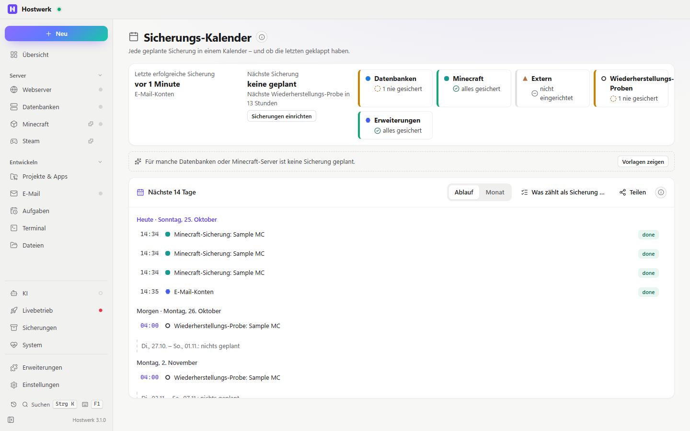

# Sicherungs-Kalender

> **Seit 3.0 mit Cloud-Sicherung:** Hier steckt auch die frühere Erweiterung „Cloud-Sicherung“ – unter Sicherungen → Cloud-Sicherung, wie bisher. Wer sie hatte, bekommt diese Fassung automatisch; Verbindung, Schlüssel und Läufe bleiben.

Wie gut sind deine Daten gesichert – und was läuft als Nächstes? Offene Fehlschläge zuerst, dann eine Ampel je Bereich, dann der Zeitplan.

[English](README.md) · Offizielle [Hostwerk](https://github.com/Passimoritz/hostwerk-public)-Erweiterung (native Erweiterung, ab Hostwerk 2.11)



## Was sie kann

- **Wo:** Sicherungen → Kalender – seit 2.1.1 ohne eigenen Seitenleisten-Eintrag; die ganze Seite bleibt unter Erweiterungen → Öffnen
- Status-Kopf: letzte erfolgreiche Sicherung, nächste Sicherung und eine Ampel je Bereich (Datenbanken, Minecraft, Projekte, extern, Wiederherstellungs-Proben, Erweiterungen) – gesichert, veraltet, nie gesichert oder fehlgeschlagen; ein Bereich klappt auf mit „Jetzt sichern“ je Datenbank oder Server
- Offene Fehlschläge ganz oben mit „Protokoll“, „Erneut ausführen“ oder „Öffnen“ – ein Fehlschlag verschwindet, sobald dasselbe wieder geklappt hat
- Zeitplan als kurzer Ablauf (leere Tage in einer Zeile zusammengefasst) oder als Monatskalender mit Markierung je Bereich; Farbe und Form je Bereich mit Legende
- Alles, was geplant ist: Aufgaben (täglich, alle paar Minuten, Cron, nach einer anderen Aufgabe; „beim Start“ steht darunter) und Hostwerks eigene Zeitpläne – nächtliche Sicherungen der Datenbanken und Minecraft-Server, externe Sicherung und Wiederherstellungs-Proben
- Was passiert ist: Aufgabenläufe, nächtliche und von Hand gestartete Sicherungen, Projekt-Schnappschüsse, externe Sicherung, Cloud-Sicherung (Erweiterung „Cloud-Sicherung“), Quellen anderer Erweiterungen wie die Spiele-Server, Wiederherstellungs-Proben
- Schnellstart ohne jede Sicherung: „Alle Datenbanken jede Nacht sichern“, „Minecraft-Welten täglich sichern“, „Eine Kopie außerhalb dieses PCs“ – legt ganz normale Aufgaben an
- Schalter „zählt als Sicherung“ je Aufgabe – für Aufgaben, die Hostwerk nicht an Art oder Namen erkennt
- Menü „Teilen“: Export als `.ics` und ein geheimer Abo-Link für Kalender-Apps
- Kachel für die Übersicht und ein Reiter im Sicherungsbereich von Hostwerk

## Installieren

In Hostwerk: **Erweiterungen → Entdecken** und „Installieren“ klicken.

Native Erweiterungen laufen als Teil von Hostwerk (eigener Server- und Oberflächen-Teil). Deshalb installiert Hostwerk sie nur aus dem offiziellen Katalog (mit Prüfsumme) oder im Entwickler-Modus.

## Daten

`data/backup-calendar.json` – deine Markierungen und der Abo-Link. Der Kalender selbst kommt aus Hostwerks Aufgaben und Sicherungen.

## Entwickeln

```bash
node --test tests/*.test.js          # Tests
node build-native.js .               # Oberfläche bauen (sdk/build-native.js aus hostwerk-public)
node check.js . --strict             # Prüfung wie im Katalog (sdk/check.js)
```

Logik ohne Seite in `lib/calendar.js`, Server-Teil in `server/`, Quelltext der Oberfläche in `ui/src`. Texte im Code sind Englisch, Deutsch steht in `locales/de.json`.

## Lizenz

MIT
