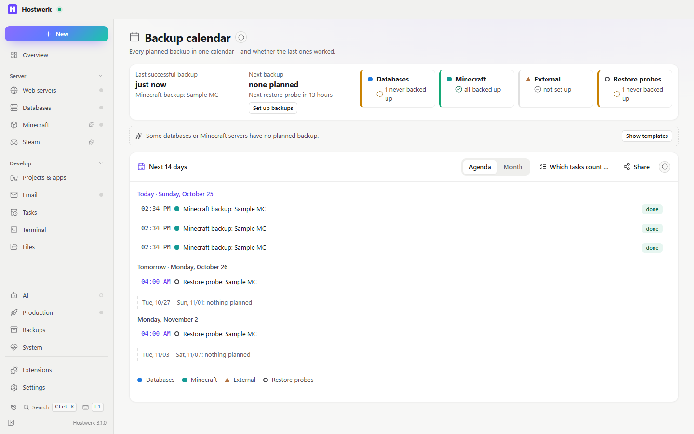

# Backup calendar

> **Since 3.0 with cloud backup:** this also contains the former extension “Cloud backup” – under Backups → Off-site → Cloud backup (older Hostwerk: Backups → Cloud backup). Anyone who had it gets this version automatically; connection, key and runs stay.

How well is your data backed up – and what runs next? Open failures first, then one light per area, then the schedule.

[Deutsch](README.de.md) · An official [Hostwerk](https://github.com/Passimoritz/hostwerk-public) extension (native extension, Hostwerk 2.11 or newer)



## What it does

- **Where:** Backups → Schedule → Calendar and Backups → Off-site → Cloud backup (Hostwerk before SDK 3.12: the tabs Backups → Calendar and Backups → Cloud backup), points on Backups → Status – no own sidebar entry since 2.1.1; the full page stays under Extensions → Open
- Status head: last successful backup, next backup and one light per area (databases, Minecraft, projects, external, restore probes, extensions) – backed up, outdated, never backed up or failed; open an area for “Back up now” per database or server
- Open failures at the top with “Log”, “Run again” or “Open” – a failure disappears once the same thing worked again
- Schedule as a short agenda (empty days folded into one line) or as a month calendar with a mark per area; colour and shape per area with a legend
- Everything that is planned: tasks (daily, every few minutes, cron, after another task; “at start” is listed below) and Hostwerk’s own schedules – nightly backups of databases and Minecraft servers, the external backup and the restore probes
- What happened: task runs, nightly and manual backups, project snapshots, external backup, cloud backup (extension “Cloud backup”), sources of other extensions such as game servers, restore probes
- Quick start without any backup: “back up every database each night”, “back up Minecraft worlds daily”, “keep a copy outside this PC” – creates normal tasks
- Switch “counts as a backup” per task – for tasks Hostwerk does not recognise by kind or name
- “Share” menu: export as `.ics` and a secret subscription link for calendar apps
- Dashboard tile and a tab in Hostwerk’s backup area

## Install

In Hostwerk: **Extensions → Discover** and click “Install”.

Native extensions run as part of Hostwerk (own server and interface part). That is why Hostwerk only installs them from the official catalogue (with checksum) or in developer mode.

## Data

`data/extensions/native/backup-calendar/` – your marks, the subscription link (`calendar.json`) and the cloud set-up (`cloud/`); “Remove completely” deletes the folder. Older data from `data/backup-calendar.json` and `data/cloud-backup/` is moved there on start. The calendar itself comes from Hostwerk’s tasks and backups.

## Develop

```bash
node --test tests/*.test.js          # tests
node build-native.js .               # build the interface (sdk/build-native.js from hostwerk-public)
node check.js . --strict             # same check as the catalogue (sdk/check.js)
```

Logic without a page in `lib/calendar.js`, server part in `server/`, interface source in `ui/src`. Texts in the code are English, German is in `locales/de.json`.

## License

MIT
